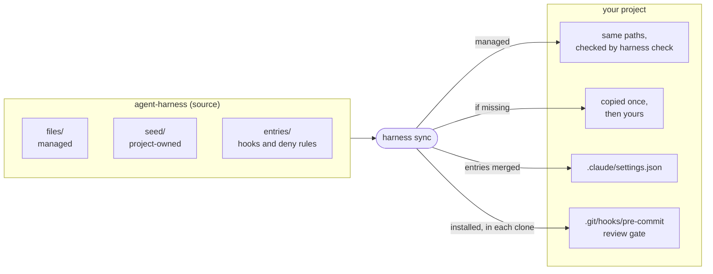
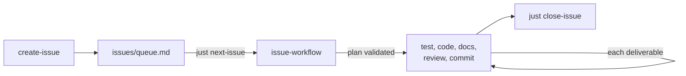

# agent-harness

One agent harness for many projects. This repository holds the Claude Code skills, hooks, checks, `just` recipes and CI
that a project needs to have an agent work its issues safely, plus `harness`, the tool that copies them into each
project and tells when a copy drifted.

## What a project gets

| | |
|---|---|
| Skills | `issue-workflow` (an issue driven to done in validated deliverables), `create-issue`, `prioritize-issues`, `write-spec`, `update-docs`, `commit-message`, `evaluate-harness`, `audit-instructions` |
| Gates | no commit without a code review of the diff, no Rust turn ending on a clippy warning, `cargo fmt` after each edit; commit messages checked (Conventional Commits, no AI attribution) |
| Recipes | `harness.just`: `next-issue`, `start-issue`, `close-issue`, `check-issue`, `check-specs`, `check-commit`, `check-harness`… |
| CI | `.github/workflows/harness.yml`: the copies and the specs checked on main and on each pull request, plus its commit messages |
| Evaluation | `harness run session-metrics`, `rule-breaches`, `delivered-quality`…: did a harness revision make the agent better? |



## Install

```sh
cargo install --path crates/harness --locked   # from a clone of this repository
cd my-project
harness init <git-url-or-path> [--rev main]    # writes .claude/harness.toml
harness sync                                   # copies, seeds, merges the settings, installs the review gate
```

Then keep the Claude Code transcripts a year, the evaluation reads them:
`{ "cleanupPeriodDays": 365 }` in `~/.claude/settings.json`.

## Commands

| Command | Does |
|---|---|
| `harness sync [--dry-run] [--force]` | brings the project in step with its source |
| `harness update [--rev <rev>] [--dry-run] [--force]` | moves a git source to a revision, syncs, pins the commit |
| `harness check` | fails when a copy drifted, the review gate is missing or a hook needs a newer `harness` |
| `harness run [<tool>]` | runs a tool of the pinned revision (hooks, checks, transcript readers); alone, lists them |

## Daily flow



Tell the agent `issues/<name>.md` (or "the next issue"); it prepares a plan, stops once for your validation, then
delivers. Details: [docs/workflow.md](docs/workflow.md).

## Read next

- [docs/usage.md](docs/usage.md): every command in detail, the evaluation, parallel worktrees.
- [docs/workflow.md](docs/workflow.md): how an issue goes from idea to merge, alone or in parallel.
- [docs/architecture.md](docs/architecture.md): how the harness is built.
- [specs/](specs/): what each capability must do; [docs/adr/](docs/adr/): why it is so.
