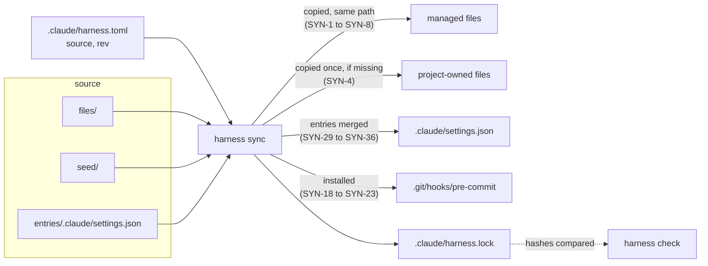
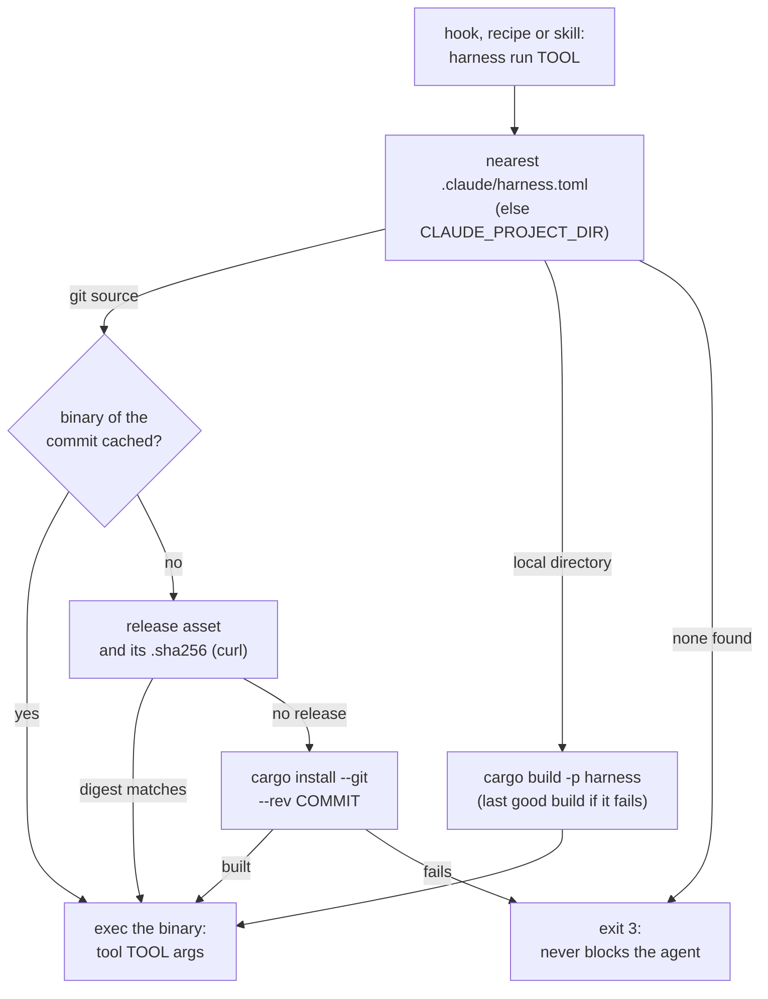
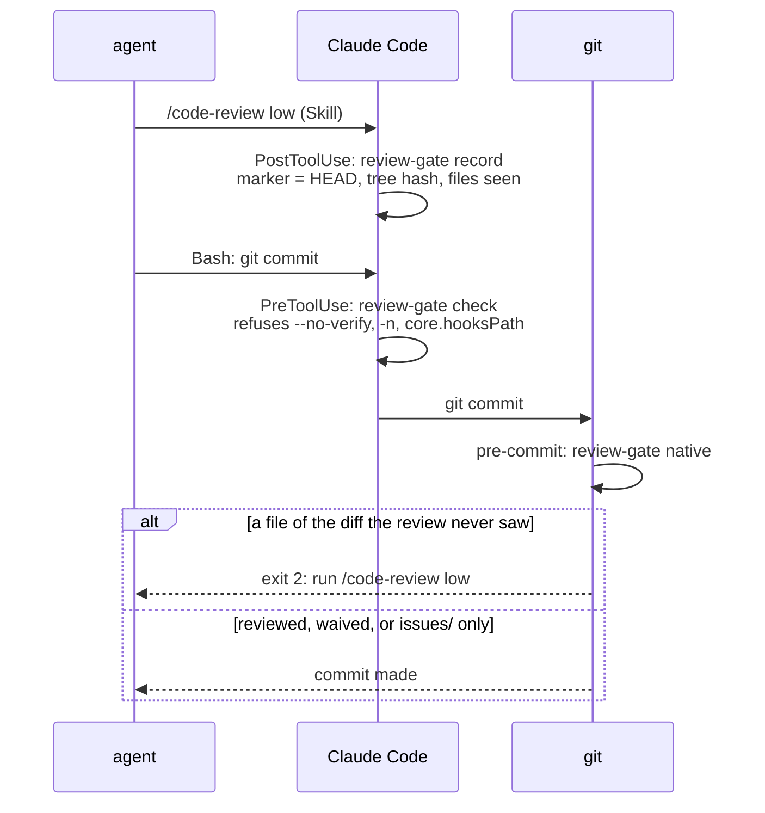

# Architecture

## What is shared, and how

A consumer project holds a `.claude/harness.toml`: the `[harness]` table (`source`, and `rev` for a git source) and
its own values (`[project]`, read by the tools and the skills). `harness sync` reads the source and writes three kinds
of things ([ADR 0001](adr/0001-shared-harness-synced-by-a-rust-tool.md), spec [`specs/sync.md`](../specs/sync.md)):

| Kind | From | Examples | Owner |
|---|---|---|---|
| Managed | `files/` | skills, `harness.just`, `AGENTS.md`, `specs/README.md`, the CI workflow and its `install_harness.sh` | the source: an edit in a project is a conflict |
| Seeded | `seed/` | `.claude/harness.toml` defaults, `.claude/settings.json`, `.claude/update-docs-map.md`, `justfile`, `issues/queue.md` | the project, from the first copy |
| Entries | `entries/.claude/settings.json` | the hooks and the deny rules of the review waiver | the source, inside a file the project owns ("Hooks and their declaration") |

`.claude/harness.lock` records the hash of each managed file and each managed entry as written. A managed file whose
hash differs from the lock was edited locally: `sync` reports a conflict instead of overwriting it and `check` fails.
The fix belongs in this repository, then `sync` everywhere; there is deliberately no merge.

Everything that differs between projects is a value, not code. The tools read lists from `.claude/harness.toml`
(`commit_scopes`, `root_docs`, `skipped_dirs`); the skills tell the agent which key to read (`roadmap`,
`architecture`, `test_conventions`, `confidential`, `user_language`); the change-to-documents table of `update-docs`
is the project's `.claude/update-docs-map.md`. Anything else project-specific (a quality benchmark, a smoke test, the
language-specific recipes of the `justfile`) stays in the project.

## Sources

A source is a directory (relative to the project) or a git URL. A git source is cloned in `$XDG_CACHE_HOME/harness`
and checked out at `rev` (default: the remote's default branch), which pins a commit, not a moving name
([ADR 0002](adr/0002-rev-pins-the-resolved-commit.md)). `harness update [--rev <name>]` resolves a name to a commit,
previews the sync, and only then syncs and writes the commit to `rev` (SYN-11 to SYN-17); a local directory has no
revision. `check` compares the project with its lock and never reads the source.

## Tools and their binary

The tools of the harness (hooks, checks, issue tools, transcript readers) are modules of the `harness` crate, one per
tool under `crates/harness/src/tools/`, listed in `TOOLS`
([ADR 0010](adr/0010-the-tools-ship-in-the-harness-binary.md), spec
[`specs/tool-binaries.md`](../specs/tool-binaries.md)). A hook, a recipe or a skill calls `harness run <tool> [args]`.
A consumer needs `harness` and `just`, and Rust only for a commit with no published binary. The tests of the tools and
of the shared content (`tests/skills.rs`, `tests/settings_hygiene.rs`) are the `cargo test` of this repository;
consumers run none.

The installed `harness` is only a launcher (`crates/harness/src/run.rs`): it finds the pinned revision and replaces
itself (`exec`) by that revision's binary, so input, output and exit code are the tool's.

| Exit | Meaning |
|---|---|
| the tool's | the tool ran |
| 1 | a drift or a conflict of `sync` and `check` |
| 2 | a hook refuses (Claude Code blocks on it) |
| 3 | the launcher could not run the tool, or `init`, `sync`, `update`, `check` failed (BIN-7, BIN-14, BIN-17, SYN-37) |

A binary pinned before BIN-7, or a launcher installed before BIN-17, exits 2 instead of 3 there, and the hook refuses.

The binaries live in `<cache>/harness/bin/<commit>/<target>/harness`, or `<cache>/harness/bin/local-<hash of the
path>/harness` for a local source, written next to their place and renamed (BIN-4). A `rev` that is no commit hash (a
branch, from `init --rev`) resolves in the clone `sync` left, without a fetch. `sync` and `update` fetch the binary
ahead.

The launcher itself is not of the pinned revision: a hook running a subcommand the installed `harness` does not know
cannot run. `check` names the `cargo install` to run (BIN-15) and `update` refuses such a revision (BIN-16);
`crates/harness/src/launcher.rs`.

This repository publishes the binaries (`.github/workflows/release.yml`, its own, not managed): each push to the main
branch builds `harness` for `x86_64-unknown-linux-musl`, `aarch64-unknown-linux-musl` (static, so they run whatever the
glibc) and `aarch64-apple-darwin`, and creates the release `harness-<commit>` with each binary and its `.sha256`. The CI
of a consumer (`.github/install_harness.sh`) installs that asset, or builds it with `cargo` when there is none, so its
jobs need no Rust when the source publishes the commit.

## Hooks and their declaration

| Event | Matcher | Tool | Does | Spec |
|---|---|---|---|---|
| `PreToolUse` | `Bash` | `review-gate check` | refuses a command that would skip the git hook | [`review-gate.md`](../specs/review-gate.md) REV-12 |
| `PostToolUse` | `Skill` | `review-gate record` | records what the code review saw | [`review-gate.md`](../specs/review-gate.md) |
| `PostToolUse` | `Edit\|Write` | `format-rust` | `cargo fmt` the project of an edited `.rs` file | |
| `Stop` | | `clippy-gate` | blocks the end of a turn while clippy reports a problem | [`clippy-gate.md`](../specs/clippy-gate.md) |
| git `pre-commit` | | `review-gate native` | refuses a commit whose diff the review never saw | [`review-gate.md`](../specs/review-gate.md) REV-9 |

Claude Code runs a hook only once declared in `.claude/settings.json`, which is seeded and then owned by the project.
The source therefore declares what it manages in `entries/.claude/settings.json`: the hooks above and the
`permissions.deny` rules of the review waiver ([ADR 0007](adr/0007-sync-manages-entries-of-the-seeded-settings.md),
`crates/harness/src/entries.rs`). `sync` adds the entries the settings lack, removes those the source dropped when they
are unchanged, records them in the lock, and leaves every other key as the project wrote it (SYN-29 to SYN-36). There is
no separate file to own instead: Claude Code reads one shared settings file per project, besides the personal
`settings.local.json`.

`check`, `sync` and `update` warn of what the settings lack or run in vain: a deny rule of the waiver, a hook under
`.claude/hooks/` the project no longer has, an attribution left on (SYN-24 to SYN-27), and a transcript retention under
a year outside CI (SYN-28, `settings::retention`), since the evaluation reads the transcripts of several revisions. A
test of the crate (`every_tool_the_shared_harness_runs_exists`) fails when a declared hook, a recipe or a skill runs a
tool `harness run` does not know.

No hook guards the attribution: the seeded settings turn it off (`"attribution": {"commit": "", "pr": "",
"sessionUrl": false}`), `harness run commit-check` rejects a credit line (run by `skill:commit-message` and by CI through
`just check-commits`), and `check` warns of settings that leave it on.

### The review gate

`review-gate` makes the code review of `issue-workflow` (step 3.5) a precondition of the commit. The gates catch the
mistakes of a cooperative agent, not deliberate bypasses
([ADR 0005](adr/0005-the-gates-catch-mistakes-not-bypasses.md)); the judgement moved from the command text to the
repository git resolves ([ADR 0004](adr/0004-review-gate-moves-from-the-command-to-the-repository.md),
`crates/harness/src/gate.rs`).

- **record** writes `claude-code-review.json` in the git directory, never in the work tree: the `HEAD`, a hash of the
  working tree against `HEAD` (tracked changes and untracked files) and the files it covers. It does not parse the
  review text. `code-review` runs forked, so the hook fires when the review ends.
- **native** recomputes that snapshot and refuses when the marker is missing, older than the last commit, or the diff
  holds a file the review never saw (REV-9, REV-10); a fix to a reviewed file passes, documentation is reviewed like
  code, and the temporary index of `git commit -a` (`GIT_INDEX_FILE`) is ignored so the snapshot is the one `record`
  took. Each linked worktree has its own marker and waiver (REV-11, REV-15).
- **check** reads a command only for what would skip the git hook (REV-12): a native hook does not run under
  `--no-verify` or `-n`, nor once `core.hooksPath` points elsewhere. A commit made by another tool is out of reach.
- **Waiver**: only the user waives the next commit, with `just waive-review` (it creates `claude-review-waived` at
  `git rev-parse --git-path`, REV-17). The managed deny rules make Claude Code refuse the agent the recipe and an edit
  of the file (REV-19); they match the command the agent usually writes, not a `touch` or a script. A waiver is stamped
  with `HEAD` when it lets a commit through and removed at the first run after `HEAD` moved, so a command that does not
  commit leaves it usable.
- **Install**: `sync` writes the git `pre-commit` (a small `sh` script marked by its second line) in the hooks
  directory of the common git directory, keeps a user's own hook as `pre-commit.user` run after it, and skips a
  `core.hooksPath` set elsewhere (SYN-18 to SYN-23); a project nested in another repository, or outside any, gets
  no gate and no error. `.git/hooks` is not cloned, so each clone needs its own `sync`. A
  missing `harness`, or a launcher that cannot run the tool (exit 3), is a warning, not a refusal.

### The Rust hooks

`clippy-gate` runs `cargo clippy` at the end of a turn only in a project with a `Cargo.toml` and a changed `.rs` file
outside the `.claude` directories, and only when the Rust state changed since the last passing run (CLG-1, CLG-4). What
it prints is billed to the agent at each turn, so it sends one short line per diagnostic, at most 40 (CLG-2, CLG-3).

The hooks that run cargo do not trust `CLAUDE_PROJECT_DIR`: a session that entered another worktree keeps it on the
main one, where another agent may work. `clippy-gate` checks the work tree of the event's `cwd` (CLG-6) and
`format-rust` runs `cargo fmt` from the directory of the edited file. For the same reason the seeded `justfile` asks
the project's `check` to print nothing on success.

## The instruction audit

`audit-instructions` and `evaluate-harness` are the skills that read outside the repository. The audit reads the
user's session transcripts, memory and instruction files under `~/.claude/projects`, through `audit-sources` (which shares the transcript reading of
the evaluation, below), and the summary of `rule-breaches`, whose rules broken often are hook candidates. It only
proposes skills and hooks;
the report holds private content, so it stays in the conversation (or a file outside the repository) and each
validated proposal becomes an issue in generic wording. It is a skill rather than a `harness` subcommand
because telling a repeated procedure from a rule needs judgment, and a skill keeps the shared files free of
project specifics.

## The evaluation from the transcripts

`harness run session-metrics` prints one tab-separated row of numbers per session of every project
(spec [`specs/evaluation.md`](../specs/evaluation.md)): tokens by kind, turns, tool calls, hook refusals, skill calls,
typed messages split into plain validations and the rest, tagged with the project, the issue branches, the models and
the Claude Code versions, and the harness revision in force: the transcripts do not record it, so it is the `rev` of
the `.claude/harness.toml` committed on the default branch of the project at the start of the session (`self:<commit>`
for this repository, the last commit touching `files/`). An assistant message is repeated on one line per content block with the same usage, so it
counts once per `message.id`; the sub-agent transcripts count with their session. The format moves between versions,
so an unreadable line, an unknown type or a missing field is counted in its own column rather than skewing the others.
No text of a message is printed, so `--archive <file>` can merge the rows into a file outside the repositories
(a session replaced by its new row, a session whose transcript is gone kept): the history then outlives the retention
of the transcripts. The transcript reading (projects, sessions, sub-agents, the typed-message filter, and the
project and harness revision a session resolves to) lives once in the module `transcripts.rs` of the tools, which `audit-sources` and
`rule-breaches` use too ([ADR 0006](adr/0006-transcript-readers-are-managed-scripts.md), its script form superseded by
ADR 0010).

`harness run rule-breaches` lists where the agent broke a rule a program can check (spec
[`specs/rule-breaches.md`](../specs/rule-breaches.md)): one row per finding, `breach` when the act went through,
`blocked` when a hook or a permission rule refused it, located by transcript line. The rules are read from the tool
calls and their results: `--no-verify`, a commit after a review refusal with no review nor user turn (a typed
message, slash command or `!` command) in between
(the bypass of [ADR 0005](adr/0005-the-gates-catch-mistakes-not-bypasses.md)), the review waiver, an edit of a path of
the project's `harness.lock` (paths made relative to the work tree of the `cwd` of each call, so an issue worktree
entered mid-session counts), and an edit outside `issues/`, `specs/` and `docs/adr/` between a proposed plan and the
user's answer. The shell words of a command exclude its quoted strings and here-documents, so a commit message that
names `--no-verify` is not a use of it. The commit messages (attribution trailer, Conventional Commits with the
`commit_scopes` of the commit itself, as `just check-commit` read them) are read from the git history of the project
instead, since a commit command rarely shows its message: a non-merge commit of a local branch counts with the
latest-starting session of the project whose span holds its author date, and a commit in no session was the user's
(a commit the agent rebased keeps the date the user wrote it; stashes and notes are on no branch). The conversation language is judged per text
block of the agent of 20 words or more once the code is removed, by counting the frequent words of French and English:
a block with more words of the other language than of the `user_language` committed then is a breach. A session whose
project had no harness then is skipped. `--summary` counts the
findings per rule and revision over the sessions where the rule applied, so a rule that rarely applies does not read
as respected.

`harness run delivered-quality [repo]` measures the quality of the delivered work from the git history
instead (spec [`specs/delivered-quality.md`](../specs/delivered-quality.md)): one row per file of `issues/done/`. The
commits of an issue are those of the default branch touching its file, from the first whose version holds
`# Tracking` outside a fenced code block to the one that moves it to `issues/done/`, except the closes of other issues that only rewrite a
citation. Its files (issue files, `docs/` and `harness.lock` left out) give the `fix` and `revert` commits of the
next `--window-days` (30) after the close; its plan lines give the deliverables, and its `Code review` lines of `# Tracking` (not the rows of the `check | result`
table) the reviews and their findings (the count opens the line, `issue-workflow` step 3.6; a line with no count leaves the sum empty); the `// spec:` lines its commits add to its files, less those they remove (a moved test traces
nothing), give the requirement ids it traced, and those missing from the id list that opens each `red:` item of
`# Tracking` count as traced with no red run (a section whose heading stands only inside a fence, such as one left
open before it, is unread: its columns are empty, not 0); the revision is the one in force just
before its first commit, so an issue that changes the harness is measured with the harness it was made with. The
sessions of an issue are those of the projects directory that made its commits (the latest-starting session of the
repository whose span holds the commit date, as for the commit rules above, a session on the issue's branch first, so
a parallel session in another worktree does not take it); within each, from the last commit of other work (from its
start on the issue's branch) to the last commit of the issue, the failed `just check…`/`just test…` runs and the typed messages, split
as `session-metrics` splits them (`is_validation`, now in `transcripts.rs`). `--summary` sums the columns per harness revision, in the order the revisions were used (a sum over an empty value
stays empty), the
input of the report by revision. These are signals, not verdicts: a later fix may come from a new need.

`harness run fixed-context` measures what a revision costs in every session before any work (spec
[`specs/harness-report.md`](../specs/harness-report.md)): one row per project and revision used by a session, the bytes
of `CLAUDE.md`, `AGENTS.md` (a symbolic link counted as its target) and the `name` and `description` of each skill
(what Claude Code loads at the start), read
from the tree of the oldest commit of the default branch where the revision is in force (the sync commit of a pin, the
commit itself for `self:`), with the list of the skills it ships. The shared hooks print nothing in a session but their
refusals, already counted.

`harness run harness-report` joins these outputs (it reads their TSV files, never the transcripts) into
one markdown table per axis. The revisions are taken in the order of their first session and cut into groups of
consecutive revisions holding at least `--min-sessions` (10) sessions, since a `self:` revision often covers one issue;
the last group, when short, shows only its size. Next to the numbers (medians per session, so one long session does
not weigh as ten) stand the sample size and the mix of models, Claude Code versions and projects (`--anonymous` keeps
only their count), the confounders a reader must weigh before reading a trend. The other tables come with their input: the quality
signals summed over the revisions of a group and over the repositories given (`--quality` once per repository), the
rules per group with the share of the sessions where they applied that broke them, the skill calls and hook refusals
with the skills shipped and never called (`--context`), and the mean fixed context. The skill `evaluate-harness`
runs the five scripts into a temporary directory and reports the trend per axis next to the confounders; the
numbers are never turned into a pass or a fail, since they would become targets.

## Parallel issues

Two agents can drive two issues at once: [ADR 0003](adr/0003-one-worktree-per-issue.md),
[ADR 0008](adr/0008-issue-worktrees-nest-under-claude-worktrees.md),
[ADR 0009](adr/0009-scanners-list-the-repository-files-through-git.md), spec
[`specs/parallel-issues.md`](../specs/parallel-issues.md). `harness run issue-worktree` (`just start-issue`,
`just finish-issue`) gives an issue the worktree `.claude/worktrees/<stem>` on a branch `<stem>`: separate working tree and
index, shared object store, so one agent's uncommitted files and commits never reach the other. Claude Code enters a
worktree there without asking for an approval; `start-issue` adds `/.claude/worktrees/` to `.git/info/exclude`, and the
tools that scan the tree, `close-issue` and `check-specs`, take their files from git (the module `repo_files.rs` of
the crate, `git ls-files -co --exclude-standard`),
which never lists a nested worktree, ignored or not, so the main worktree never sees the nested ones. `close-issue` then drops `.git`,
`target`, `node_modules` and the `skipped_dirs` of `.claude/harness.toml` by directory name; `check-specs`
walks the disk only outside a git repository. A project's own tools run on `.` may still read the nested
worktrees (measured in ADR 0009); [usage.md](usage.md) says how to keep them out. `finish-issue` still removes a
worktree left at the former sibling path `../<repo>-<stem>`. Each worktree has its
own `target/` (measured once, on this repository and a 24-core machine: 239 MB and a cold build in 4 s; a larger
project may want a shared `CARGO_TARGET_DIR`, which is then the project's choice). The mark "taken" is the worktree itself, or a branch holding commits that are not on the main branch:
`next-issue` reads `git for-each-ref`, `git worktree list`, `git cherry` and `git merge-tree --write-tree`, so every worktree sees it and no file
needs cleaning. A leftover branch with neither is listed `Stale:` and `just finish-issue` cleans it (merged by
ancestry, patch equivalence, or a merge that would change no file, which covers a squash of any number of commits; `--force` for work that is not on the main branch). `just finish-issue` also refuses, `--force` or not, when run from inside the worktree it would remove. The queue is edited only at merge time: `close-issue` refuses in a linked worktree and refuses an issue of one, whatever directory it runs from. The worktree is the user's choice, for parallel work
([ADR 0011](adr/0011-the-user-opens-the-issue-worktree.md)): an agent works where its session was started and never
creates or enters one, since Claude Code isolates a session entered with `EnterWorktree` and refuses every command it
cannot prove stays there. The user runs `just start-issue` and launches a plain `claude` in the worktree; the
session's `cwd`, and the `cwd` of the hook events, are the worktree. The hooks act on the work tree of that `cwd`
(a session launched in the worktree has it as `CLAUDE_PROJECT_DIR`, so the worktree's `.claude/settings.json`
declares them, and `harness run` takes the revision of the `harness.toml` it finds from the `cwd`): `review-gate` keeps its marker and waiver in the git directory of each
worktree (`git rev-parse --git-path`), `format-rust` and `clippy-gate` run cargo there. `.claude/` is tracked, so each worktree holds its own copy of the harness (a project that does not track `.claude/` gets bare worktrees). At the close, the agent rebases the branch, runs `just check-harness` there (and installs the `harness` of the branch when the installed one refuses a hook of it, BIN-15), then prints the commands left to the user in the main worktree: fast-forward the main branch, `just close-issue`, `just finish-issue`.

## The cost of a turn

Everything a check prints is read by the agent and billed as tokens, every turn it runs. Measured on this repository
(bytes / 4 ≈ tokens):

| Output | Before | After |
|---|---|---|
| `just check`, success | 86 lines, 5.6 kB | nothing |
| clippy gate, 3 errors | 35 lines, 1.9 kB | 4 lines, 0.4 kB |
| clippy gate, end of turn with no new Rust change | a full clippy run | no run |

The model is the other lever, and the shared settings deliberately do not choose it: it depends on the user's plan
and the project. The setup that costs least for `issue-workflow` is a strong model where judgment matters (steps 1
and 2: preparation in the files, single validation stop; the final `high` review) and a cheaper one for the mechanical part (step 3: test,
code, docs, the `low` review, the commit). Switch with `/model` after the plan is validated; `/model opusplan`
does not fit, since plan mode is read-only and step 1 writes the issue. Forked
skills and sub-agents follow the session model unless the user sets `CLAUDE_CODE_SUBAGENT_MODEL` in their own
settings.
